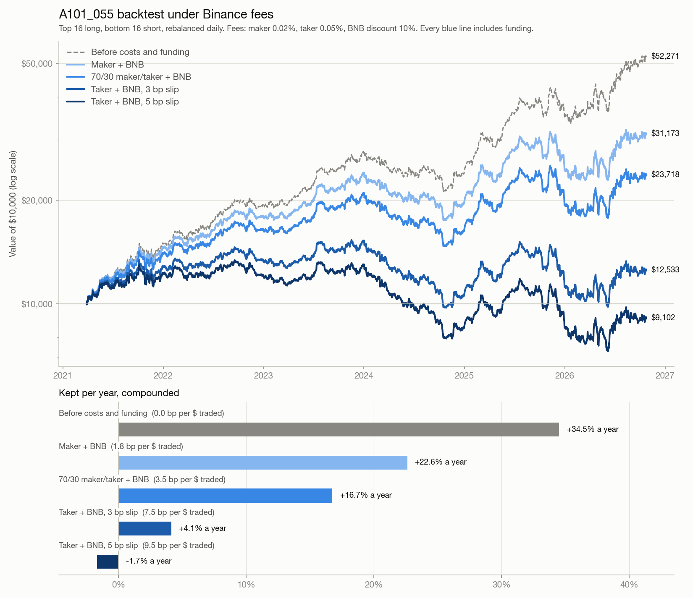
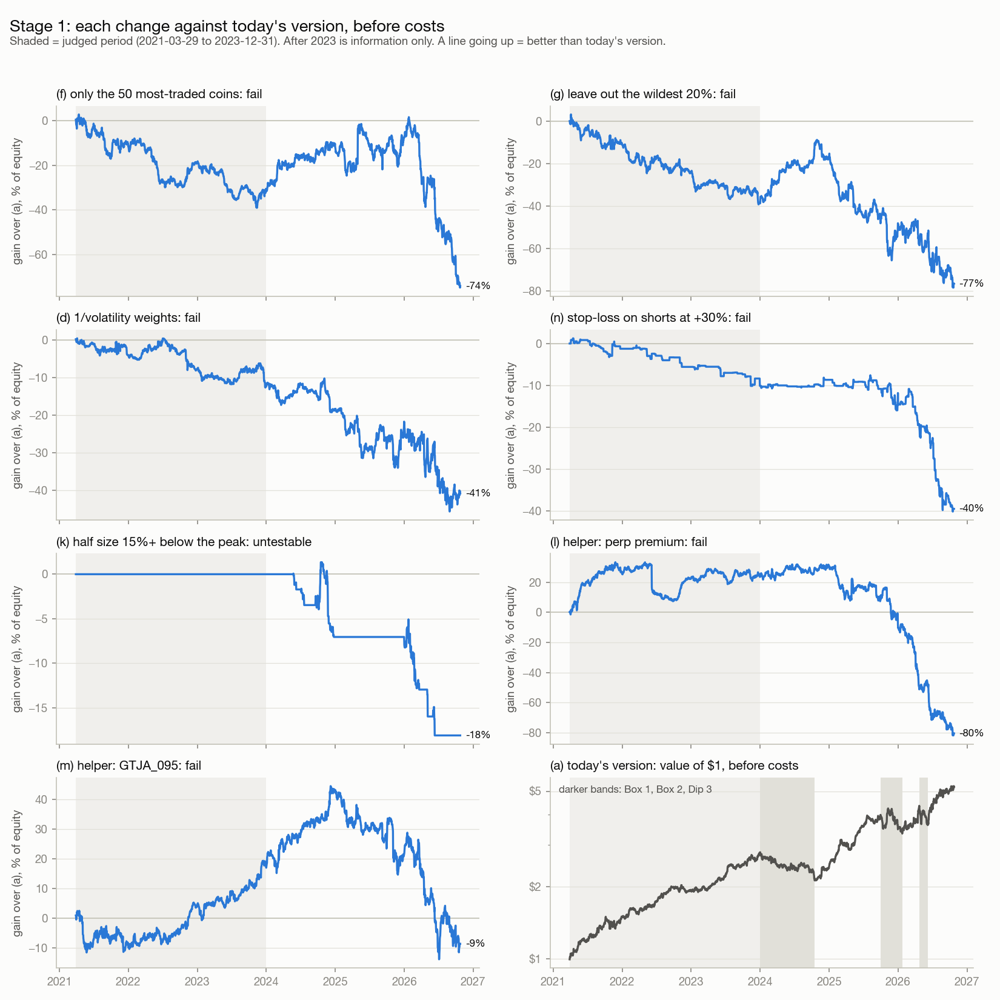
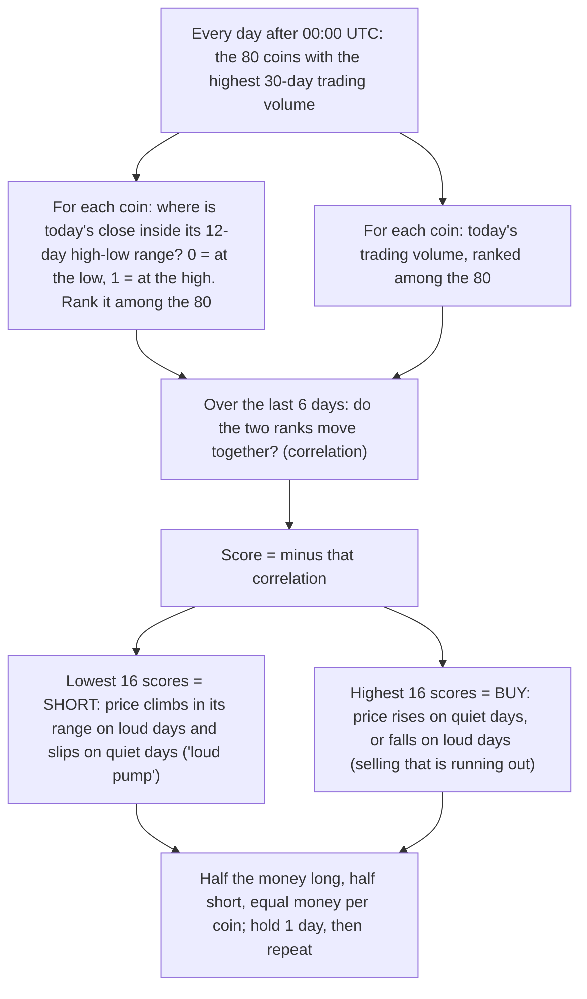
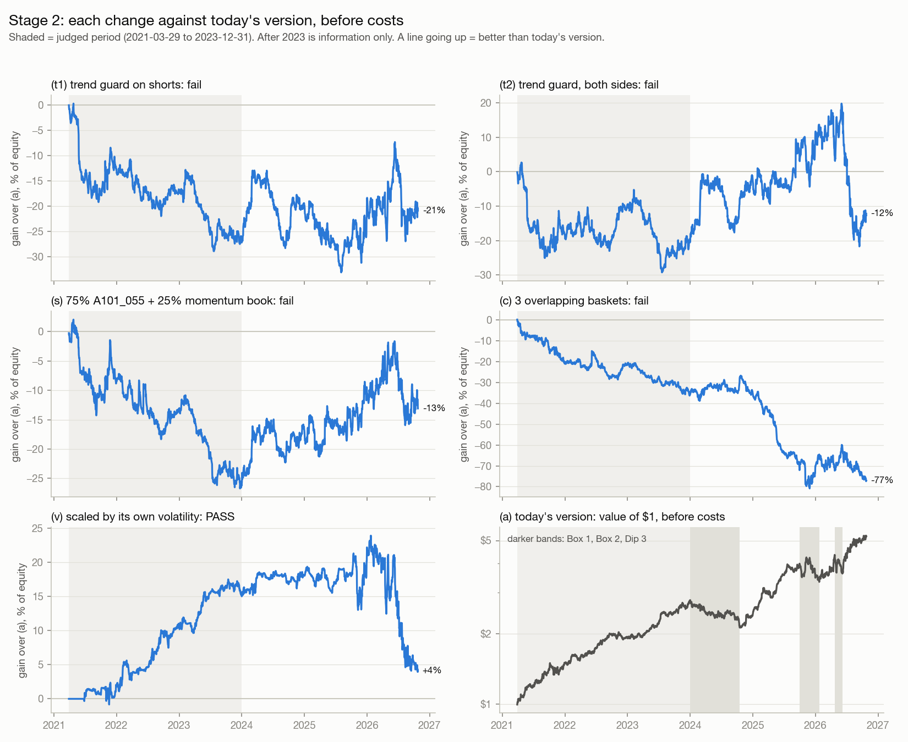
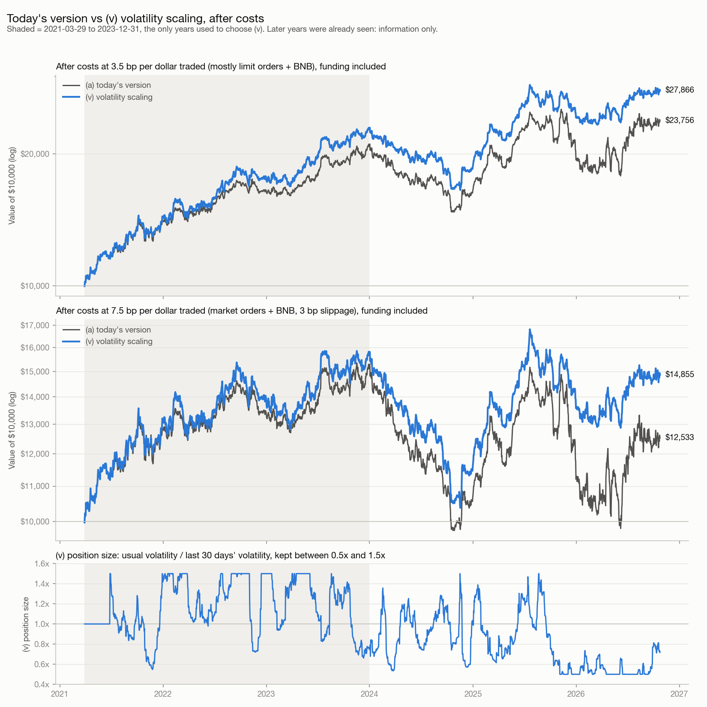
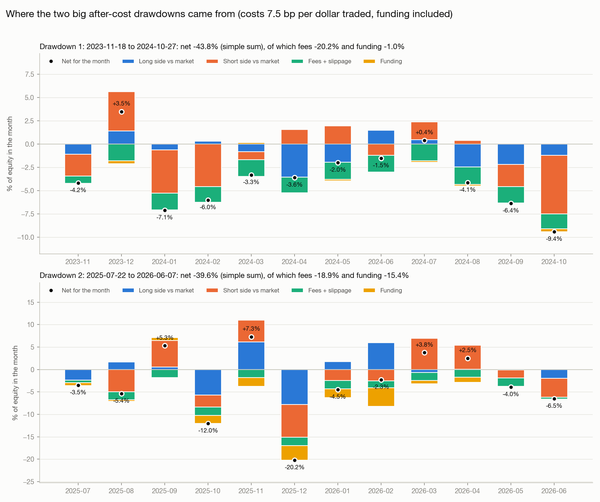

# A101_055 lab

A research lab for alpha **A101_055**: make it more robust and cheaper to trade, analyse it, and try combining it with other alphas.
No trading happens here: no orders, no API keys.

```
A101_055 = -1 * correlation(rank((close - ts_min(low, 12)) / (ts_max(high, 12) - ts_min(low, 12))),
                            rank(volume), 6)
```

## Where things stand (summary, 2026-10-27)



**What is clear now**
1. **The signal is real before costs.**
   - Next-day rank IC is +0.038 (t 13.6).
   - Before costs and funding, the backtest makes +34.5% a year (Sharpe 1.5) over 2021-03 to 2026-10.
2. **What the edge is.** A101_055 shorts coins that pushed to the top of their 12-day range on a rush of volume, and buys the opposite. Normally those pumps fade the next day. That fading is most of the profit.
3. **Why it has bad periods.**
   - About once every year or two, for months at a time, the pumps keep going instead of fading. Before costs that gives drawdowns of 17-24% (2024, 2025-10 to 2026-01, 2026-04 to 06).
   - The worst single days are short squeezes: one shorted coin jumps +50% to +120% in a day.
   - No market condition we checked predicts these periods.
4. **No change found so far fixes the bad periods.** Stage 1's filters and stage 2's trend guard, momentum book and longer holding all helped in the bad windows but cost money in normal times. Only volatility scaling passed: same return, slightly less risk.
   Earlier note: **simple risk filters do not fix it.** Leaving out wild or less-traded coins, a stop-loss, a drawdown brake or a helper alpha all failed (stage 1). The coins that hurt in bad periods are the same coins that pay in good ones.
5. **Costs decide whether it makes money.**
   - The strategy trades 79% of the account every day, so each 1 bp of cost per trade costs about 2.9% a year.
   - With Binance market orders it keeps about +4% a year. With mostly limit orders, +17-23%. Break-even is 9.7 bp per dollar traded.
6. **The risk is bigger than 2021-2023 suggests.** Plan for drawdowns of 20-30% before costs and 30-45% after costs.

**Not solved yet**
- How to avoid the bad periods. Nothing found so far.
- How many limit orders would really fill, and what slippage really is. One paper-trading day measured 3 bp.

**Next**
1. Measure real costs: daily paper trading for slippage, and limit orders on the demo account for fill rates.
2. Test "trade less" versions after costs (3-day score average, overlapping baskets). The signal fades slowly, so this could cut costs without losing much edge.
3. Set the position size so that a 30-45% drawdown can be survived.

## Where it came from

- `a101_055.py`, `backtest.py` and `get_history.py` are unchanged copies from the A101_055 repo (`github.com/weijunZhou02/A101_055`, commit `f0cce0a`, 2026-10-26).
- The live demo trading, paper trading, dashboard and schedule stay in that repo.
- Data: a frozen snapshot of Binance daily candles and funding, delisted coins included, up to **2026-10-24**. It is `data/klines_1d.csv.gz` and `data/funding.csv.gz`, 27 MB, not in git. Their checksums are in `baseline/data_sha256.txt`.

## Setup

```bash
python3 -m venv .venv
.venv/bin/pip install -r requirements.txt
mkdir -p data && cp ../A101_055-main/data/*.csv.gz data/
.venv/bin/python check_baseline.py
```

## Files

| File | What it is |
| --- | --- |
| `a101_055.py`, `backtest.py`, `get_history.py` | Unchanged copies of the original scripts |
| `check_baseline.py` | Confirms the lab still reproduces the original backtest |
| `stage0.py` | Stage 0: facts and post-mortem, after costs (writes `results/stage0/`) |
| `stage0b.py` | Stage 0b: post-mortem on the before-cost line (writes `results/stage0b/`) |
| `make_helpers.py` | Exports the two helper alphas from the main Alpha-mining project to `data/helpers.csv.gz` (run with the main project's Python) |
| `experiment.py` | Stage 1: tests each change against today's version (writes `results/stage1/`) |
| `cost_scenarios.py` | Today's version re-priced under Binance fees (writes `results/costs/`) |
| `stage0c.py` | Stage 0c: why the bad windows happened (writes `results/stage0c/`) |
| `stage2.py` | Stage 2: trend guard, momentum book, holding longer, volatility scaling (writes `results/stage2/`) |
| `after_costs_chart.py` | Today's version vs (v) after costs, and (v)'s position size (writes `results/stage2/after_costs.png`) |
| `drawdowns.py` | The two big after-cost drawdowns, month by month (writes `results/drawdowns/`) |
| `baseline/` | The original backtest's summary, daily results, a live list, and data checksums |
| `results/` | Tables from each stage (kept in git) |

## The baseline check

`check_baseline.py` makes sure the lab still gives the original numbers. It:
1. checks that the data is the frozen snapshot,
2. runs `backtest.py`,
3. compares the summary and every day's result with the original (`baseline/`).

It must say **PASS** before any experiment is trusted. Run it again after changing `a101_055.py` or `backtest.py`.

The original numbers (2021-03-29 to 2026-10-24, 7 bp per unit traded):

| | |
| --- | --- |
| Rank IC, next day | +0.0379 (t 13.6) |
| Sharpe before / after costs | 1.52 / 0.36 |
| Before costs / after costs | +8.7 / +2.1 bp a day |
| Turnover | 79% of equity a day |
| Break-even cost | 9.7 bp per unit traded |

## Rules that keep the results honest

Every year from 2021 to 2026 has already been seen, so:
1. **Choose only on 2021-03-29 to 2023-12-31.** Show 2024 and 2025-01-01 to 2026-10-24 as information only, never to pick anything.
2. **Write down the versions to try before running (about 6 at most) and report all of them.**
3. **"Better"** = a higher Sharpe after costs than the baseline on 2021-2023 **and** t ≥ 2 on the day-by-day difference.
4. **The real test is days after 2026-10-24.** Download them into another folder (`get_history.py --datadir data_fresh`) so the snapshot stays frozen. Declare the test before looking.
5. **Improvements go back to the A101_055 repo by hand**, and only after they pass.
6. **No API keys in this folder.**
7. **Post-mortems may suggest ideas, never choose them.** Studying a bad period (for example 2024) can give guesses. Each guess becomes a rule with round numbers fixed in advance. It is still chosen on 2021-2023 and judged on new days. Never tune a rule's numbers to the shape of the bad period.

## How each step is recorded

Every step gets two commits, both pushed to GitHub:
1. **Declare**: the plan is written here before anything runs.
2. **Results**: the numbers and the verdict are added to the research log below.

## Research log

### Stage 0: facts and post-mortem (declared 2026-10-27)

Describes only. Nothing is tested, nothing is chosen, and the strategy does not change.

The script `stage0.py` re-runs the original backtest on the frozen data and saves tables to `results/stage0/`.

**Periods**, fixed from the after-cost drawdown dates of the original backtest:

| Name | Trade days | Role |
| --- | --- | --- |
| Train | 2021-03-29 to 2023-12-31 | Normal life (0A) |
| Bad 1 | 2023-11-18 to 2024-10-22 | Drawdown of −35.6% (peak 2023-11-17) |
| Bad 2 | 2025-07-22 to 2026-06-07 | Drawdown of −34.5% (peak 2025-07-21) |
| Other | 2024-01-01 to 2026-10-24, outside Bad 1 and Bad 2 | Recoveries, information only |

Bad 1 overlaps the last 6 weeks of Train.

**What is measured in each period:**
1. Where the money went: long side and short side (each against the market average), fees, funding by side, rank IC and turnover.
2. Which coins: profit by volatility group, liquidity group and coin age, for each side. Also the 10 coins that lost the most, and their share of the loss.
3. Market conditions: market trend and volatility, BTC against altcoins, how spread out coin returns are, and average funding.
4. The 20 worst days in the whole history: what moved, and which single coins hurt most.
5. How unusual the drawdowns were:
   - the worst 12-month stretch inside Train, against 2024;
   - how deep drawdowns get when Train's daily results are reshuffled in 30-day blocks (2,000 paths).

**Output:** tables below, plus a list of guesses tagged "born from bad periods". These guesses can become rules for stages 1-4 (rule 7).

#### Stage 0 results (run 2026-10-27)

The re-run equals the original backtest on all 2,036 days. All tables are in `results/stage0/`.

**1. Where the money went** (bp a day; each side measured against the market average)

| | Train | Bad 1 | Bad 2 | Other |
| --- | --- | --- | --- | --- |
| Days | 1,008 | 340 | 321 | 411 |
| After costs, compounded | +58% | −36% | −35% | +102% |
| Before costs, compounded | +177% | −22% | −9% | +169% |
| Sharpe after costs | 1.10 | −2.54 | −1.45 | 2.69 |
| Long side vs market | +4.2 | −3.1 | −0.8 | +10.2 |
| Short side vs market | +6.3 | −3.7 | −0.9 | +14.8 |
| Fees + slippage | −5.5 | −5.5 | −5.5 | −5.5 |
| Funding (long + short) | 0.0 | −0.3 | **−4.8** (long +4.1, short −8.9) | −1.6 |
| **After costs** | **+4.9** | **−12.5** | **−11.9** | **+17.9** |
| Rank IC (t) | 0.041 (10.6) | 0.017 (2.4) | 0.030 (4.2) | 0.051 (8.7) |

- **Neither drawdown was a crash.** The edge faded (Bad 1: both sides lost a little; Bad 2: both sides about zero) while fees kept costing 5.5 bp every day. Zero edge plus fees is about −20% a year.
- **The ranking never broke.** The IC stayed positive in both bad periods. But the 16 + 16 coins at the two ends didn't pay.
- **Bad 2 added funding:** the shorts paid 8.9 bp a day.

**2. Which coins** (bp a day of the book, price against the market plus funding)

| Group | Train short | Bad 1 short | Bad 2 short | Other short |
| --- | --- | --- | --- | --- |
| Calm third | +1.7 | −0.9 | +0.4 | −1.1 |
| Middle third | +2.6 | +2.2 | +0.2 | +1.8 |
| **Wild third** | +2.6 | −3.4 | **−10.3** (funding −7.9) | **+10.3** |

- **Wild-coin shorts swing the whole result.** In Bad 2 they lost 10.3 bp a day, mostly funding. In the recoveries they earned 10.3.
- **Bad 2 losses were concentrated.** The 10 worst coins cost 43% of equity, more than the whole period's loss (38%, simple sums). FHE cost 8.5% and POWER 6.8%, both recently listed hype coins.
- **Bad 1 was a broad bleed.** The 10 worst coins (SUI, RUNE, ENS, WIF, BONK, …) cost 29% of a 42% loss. On the long side, coins listed over a year lost 5.9 bp a day.
- **Less liquid coins hurt in both bad periods** (places 51-80 by volume). But they also earned well in Train and in the recoveries.

**3. Market conditions**

| | Train | Bad 1 | Bad 2 | Other |
| --- | --- | --- | --- | --- |
| Market (top-80 average) bp/day | +3.2 | +12.1 | −27.7 | +0.7 |
| Market volatility, % a year | 92 | **77** | **73** | 81 |
| BTC minus market bp/day | −0.7 | +9.6 | +11.2 | +21.3 |
| Spread of coin returns (daily std) | 4.2% | 4.3% | 7.0% | 6.2% |
| Coins with funding < −0.1%/day | 4.9% | 2.0% | **12.9%** | 7.2% |
| Coins with funding > +0.1%/day | 7.2% | 11.8% | 4.3% | 4.1% |

- Bad 1 was a calm, BTC-led rally with positive funding. Bad 2 was an altcoin fall full of crowded shorts (negative funding).
- So no single market condition explains both. "BTC beat altcoins" happened even more in the recoveries.
- The one thing both bad periods share: **the market was calmer** than in Train and in the recoveries.

**4. The 20 worst days**
- In 18 of the 20, the coin that hurt most was a **short that jumped**, by +13% to +123% in a day, often costing 2-4% of equity by itself.
- 11 of the 20 are in Bad 2.
- The worst day: −4.9% on 2026-02-11, when BERA (short) rose +89%.

**5. How unusual were the drawdowns?**

| | Worst 12 months inside Train | Calendar 2024 |
| --- | --- | --- |
| After costs | −3% | −29% |
| Before costs | +18% | −13% |
| Rank IC (12-month average) | 0.034 (lowest) | 0.021 |

Reshuffling the daily results in 30-day blocks gives 2,000 paths of 2,036 days each:

| | Train days only | All days (information) |
| --- | --- | --- |
| Typical (median) worst drawdown | −17% | −36% |
| 1 path in 10 is worse than | −24% | −53% |
| Paths with a drawdown as deep as −35.6% | **0.5%** | 50% |

- **2021-2023 badly understates the risk.** If the future looked like Train, a −35% drawdown would happen in 1 path out of 200. It happened twice in 5.6 years.
- Train is also the period A101_055 was picked on, so it flatters the alpha.
- **For planning the money:** expect drawdowns of 35-55% with the current version. Position size has to survive that.

#### Guesses born from bad periods (rule 7: test on 2021-2023 and new days, never tune to 2024-2026)

| # | Guess | Evidence | Possible rule (round numbers) |
| --- | --- | --- | --- |
| G1 | Short squeezes cause most of the worst days | 18 of the 20 worst days; Bad 2's top-10 losers | Stop-loss on each short at +30% within the day (daily highs allow a rough test). Also (g) and (d) |
| G2 | Funding on wild shorts | Bad 2: −7.9 of −10.3 bp a day | Funding guard (h), already planned |
| G3 | The edge is weaker in calm markets | Market volatility 77% and 73% in the bad periods vs 92% in Train | First a fact check inside Train: do calmer months earn less? This matters for (j): volatility targeting makes the book *bigger* in calm markets, which this guess says is the wrong way |
| G4 | Fees cause the bleed when there is no edge | 5.5 bp a day in every period | Stage 1 (trade less), already planned |

### Owner's decision (2026-10-27): judge before costs from now on

- **All comparisons from now on use the before-cost line**: no fees and no funding, the grey dashed line on the chart.
- **Every table still shows turnover**, so we can see if a version wins only because it trades more.
- **Stage 0's tables above are after costs.** Its periods came from the after-cost line. That line made Bad 2 eleven months long, covering months where the signal was fine. As a result, it hid a sharp failure from 2025-10 to 2026-01.

### Stage 0b: post-mortem on the before-cost line (declared 2026-10-27)

Describes only. Nothing is tested or chosen. The script `stage0b.py` writes its tables to `results/stage0b/`.

**Periods**, from the before-cost drawdowns of the original backtest:

| Name | Trade days | Before-cost drawdown |
| --- | --- | --- |
| Train | 2021-03-29 to 2023-12-31 | Normal life |
| Box 1 | 2024-01-02 to 2024-10-17 | −23.7% (peak 2024-01-01) |
| Box 2 | 2025-10-01 to 2026-01-23 | The 10 October crash (−12.5%), then −21.4% from 2025-11-09 |
| Dip 3 | 2026-04-24 to 2026-06-07 | −16.9% (peak 2026-04-23), not circled by the owner; information |
| Other | 2024-01-01 to 2026-10-24, outside the three above | The rest of 2024-2026 |

**Measured**, all before costs:
1. Long and short side (each against the market average), rank IC and turnover.
2. **New: did the whole ranking flip, or only the two ends?** For each period, the average next-day return (against the market) of the 5 groups of 16 coins, from best score to worst.
3. Which coins: volatility, liquidity and age groups, and the biggest losers.
4. Market conditions.
5. The 20 worst days before costs.
6. How unusual: the worst 12 months inside Train, and how deep before-cost drawdowns get when Train's days are reshuffled in 30-day blocks.

#### Stage 0b results (run 2026-10-27, before costs)

The re-run equals the original backtest. All tables are in `results/stage0b/`.

**1. The periods** (bp a day; each side measured against the market average)

| | Train | Box 1 | Box 2 | Dip 3 | Other |
| --- | --- | --- | --- | --- | --- |
| Days | 1,008 | 290 | 115 | 45 | 578 |
| Before costs, compounded | +177% | −24% | −16% | −17% | +256% |
| Sharpe before costs | 2.34 | −1.81 | −1.69 | −4.16 | 3.34 |
| Long side vs market | +4.2 | −3.8 | −6.3 | −13.7 | +9.2 |
| Short side vs market | +6.3 | −5.1 | −8.0 | −25.7 | +13.7 |
| Rank IC (t) | 0.041 (10.6) | 0.017 (2.0) | 0.017 (1.8) | 0.000 (−0.2) | 0.051 (9.8) |
| Turnover, % a day | 79 | 78 | 79 | 79 | 78 |

**2. Did the whole ranking flip?** (next-day return against the market, bp a day, 5 groups of 16 coins)

| | Train | Box 1 | Box 2 | Dip 3 | Other |
| --- | --- | --- | --- | --- | --- |
| Q1, best scores (≈ BUY list) | +7.2 | −4.6 | −10.5 | −33.4 | +20.2 |
| Q2 | +3.7 | +2.6 | +1.7 | −16.3 | +2.5 |
| Q3 | +2.0 | −8.6 | −13.1 | −9.0 | +1.4 |
| Q4 | +1.6 | −2.2 | +9.4 | +29.9 | +4.6 |
| Q5, worst scores (≈ SHORT list) | **−13.6** | **+12.7** | **+14.0** | **+24.4** | **−27.6** |

- **The worst-score group is the swing.** These are coins whose price rose to the top of its 12-day range together with a rush of volume. Normally they fall the next day: −13.6 bp a day in Train and −27.6 in the rest of 2024-2026. Most of the alpha's edge comes from here.
- **In every bad window, those coins kept rising instead** (+12.7 to +24.4). The pumps continued rather than fading.
- In Box 1 and Box 2 the two ends flipped while the middle was mixed, so the IC stayed slightly positive. In Dip 3 the whole ranking flipped.

**3. Which coins**
- **Less-traded coins carried the losses.** In Box 2 and Dip 3 the losses came from coins ranked 21-80 by volume. The 20 most-traded coins made money on both sides in Box 2 (+2.9 long, +4.4 short) and on the long side in Dip 3.
- **Wild coins as well:** shorts of the wildest third lost 5.4 bp a day in Box 1, 6.3 in Box 2 and 28.5 in Dip 3.
- **Concentration:**
  - Box 2: the 10 worst coins together lost 31% of equity (FHE alone 7.4%), against −16% for the whole window (simple sums).
  - Box 1: 27% against −26%.

**4. Market conditions**

| | Train | Box 1 | Box 2 | Dip 3 | Other |
| --- | --- | --- | --- | --- | --- |
| Market (top-80 average) bp/day | +3.2 | −0.1 | −39.9 | −21.9 | −3.6 |
| Market volatility, % a year | 92 | 79 | 82 | 57 | 78 |
| BTC minus market bp/day | −0.7 | +18.5 | +21.2 | −23.2 | +18.1 |
| Spread of coin returns (daily std) | 4.2% | 4.2% | 7.1% | 7.3% | 6.4% |
| Coins with funding < −0.1%/day | 4.9% | 2.1% | 14.0% | 7.4% | 9.0% |

- No market condition separates the bad windows from the good months of 2024-2026 ("Other").
- BTC beat altcoins just as much in Other. Market volatility in Box 1 and Box 2 was the same as in Other.
- **Guess G3 from stage 0 ("calm markets are bad") is not supported on the before-cost line. It is dropped.**

**5. The 20 worst days before costs:** 17 were a shorted coin jumping, from +13% to +123% in a day. 10 of the 20 fall inside the three windows.

**6. How unusual**
- Train never had a losing 12-month stretch before costs; its worst was +18%. The worst in the whole history was −20%, the 12 months to 2024-11-16.
- Reshuffling Train's days gives a drawdown as deep as −23.7% in 1 path out of 1,000. Its typical worst drawdown is −11.5%.
- Using all days (information only), the typical worst drawdown is −20%, and 1 path in 10 is worse than −28%.
- **Plan for before-cost drawdowns of 20-30%**, not the 10-15% that 2021-2023 suggests.

#### Guesses after stage 0b (rule 7: test on 2021-2023 and new days, never tune to 2024-2026)

| # | Guess | Evidence | Possible rule (round numbers) |
| --- | --- | --- | --- |
| G1 | Short squeezes cause the worst days | 17 of the 20 worst days | Stop-loss on each short at +30% within the day; smaller bets on wild coins; leave out the wildest 20% |
| G5 | Less-traded coins carry the losses in bad windows | Box 2 and Dip 3: losses in coins ranked 21-80 by volume, while the top 20 made money | Only the 50 most-traded coins |
| G6 | Bad windows are times when pumps keep going | The SHORT-list group rose in every bad window | A drawdown brake. Watching the short list's own recent results is possible but easy to overfit |
| ~~G3~~ | ~~Calm markets are bad~~ | Not supported before costs | Dropped |
| G2, G4 | Funding, fees | — | Parked: costs are ignored for now |

### Stage 1: test 7 changes, each alone against today's version (declared 2026-10-27)

**Setup**
- **Before costs:** no fees and no funding. Turnover is shown for every version.
- **Judged on trade days 2021-03-29 to 2023-12-31 only.**
- **Shown as information** (never used to choose): 2024, 2025-01-01 to 2026-10-24, Box 1, Box 2 and Dip 3.
- **Script:** `experiment.py`. Its version (a) must first reproduce today's backtest exactly: before-cost return and turnover on every day.

**The 7 versions.** Each one changes a single thing; everything else stays as in (a).

| | Change |
| --- | --- |
| (f) | **Only the 50 most-traded coins.** Tradable = the day's universe coins ranked 1-50 by 30-day average volume. BUY = the best 16 tradable coins by score, SHORT = the worst 16 tradable coins. Ties at place 16 are kept, as today. |
| (g) | **Leave out the wildest 20%.** Tradable = universe coins except the 20% with the highest 30-day volatility (std of daily close-to-close returns, at least 20 days). Lists are refilled as in (f). |
| (d) | **1/volatility weights.** Same coins as (a). Inside each side, weight ∝ 1 / 30-day volatility. Each side is still 50% of equity. |
| (n) | **Stop-loss on shorts.** Same coins and weights as (a). If a shorted coin trades 30% above that day's open (seen in the daily high), the short is closed and its loss counts as 31%. It is re-entered at the next open if it is still on the list. |
| (k) | **Drawdown brake.** Same as (a), but all weights are halved on days when (a)'s before-cost equity (up to the day before) is 15% or more below its peak. Known before running: (a)'s worst before-cost drawdown in 2021-2023 was −10.9%. So (k) probably never triggers in the judging period; then it cannot pass and is reported as "untestable on 2021-2023". |
| (l) | **Helper: perp premium.** Score = 0.7 × daily rank of A101_055 + 0.3 × daily rank of CRYPTO_HMRW_PREMIUM. Ranks are within the day's universe. The helper's direction comes from the main project's training scorecard (−1: buy coins whose perp trades cheap). A missing helper value counts as the middle rank. |
| (m) | **Helper: GTJA_095** (buy coins with smaller, steadier trading value; direction −1). Same blend as (l). |

Helper values come from the main Alpha-mining project's alpha engine (`make_helpers.py`, commit `fb06995`, data to 2026-10-21).

**Rules**
- **Measures:**
  - Sharpe = mean / std × √365 of daily before-cost returns.
  - t = simple t-statistic of the day-by-day difference from (a).
  - Worst drawdown is compounded inside the period.
  - "Worst 1% of days" = the average of the worst 1% daily returns.
- **Rule A (l, m):** on Train, Sharpe above (a) **and** t ≥ 2 **and** Sharpe above (a) in at least 2 of 2021, 2022 and 2023.
- **Rule B (f, g, d, n, k):** on Train, a smaller worst drawdown than (a) **and** a smaller worst 1% of days **and** t above −1.

**Final version**
- All passing versions together, applied in this order: helper score → coin filters → lists → weights → brake → stop. If both helpers pass, the blend is 0.6 / 0.2 / 0.2.
- The combination must pass every rule that its parts passed. Otherwise the final version is the single passer with the highest Train Sharpe.
- If nothing passes, today's version stays.

#### Stage 1 results (run 2026-10-27, before costs)

- Version (a) reproduced the original backtest on all 2,036 days (largest gap 5e-10).
- The helper alphas had a value for 99.7% of coin-days in 2021-2023.
- Files: `results/stage1/` (`judged.csv`, `information.csv`, `daily_gross.csv`, `versions.png`).

**Judged on 2021-03-29 to 2023-12-31**

| | Change | Rule | Sharpe | bp/day | Worst drawdown | Worst 1% of days | vs (a), bp/day (t) | Years better | Turnover | Verdict |
| --- | --- | --- | --- | --- | --- | --- | --- | --- | --- | --- |
| (a) | today's version | - | 2.34 | 10.5 | −10.9% | −2.91% | - | - | 79% | yardstick |
| (f) | only the 50 most-traded coins | B | 1.62 | 7.4 | −16.3% | −3.04% | −3.1 (−1.46) | 0 | 65% | fail: all three checks |
| (g) | leave out the wildest 20% | B | 1.82 | 6.7 | −13.2% | **−2.14%** | −3.8 (−1.80) | 0 | 74% | fail: drawdown, t |
| (d) | 1/volatility weights | B | 2.41 | 9.3 | −11.2% | **−2.07%** | −1.2 (−1.13) | 2 | 82% | fail: drawdown (by 0.3 points), t |
| (n) | stop-loss on shorts at +30% | B | 2.13 | 9.5 | −11.7% | −2.64% | −1.0 (−1.64) | 0 | 80% | fail: drawdown, t (139 stops) |
| (k) | half size 15%+ below the peak | B | 2.34 | 10.5 | −10.9% | −2.91% | 0 | - | 79% | untestable: never triggered |
| (l) | helper: perp premium | A | 2.42 | 12.8 | −19.5% | −4.28% | +2.3 (0.97) | 2 | 97% | fail: t |
| (m) | helper: GTJA_095 | A | **2.61** | 12.3 | −11.2% | −3.08% | +1.8 (0.94) | 2 | 73% | fail: t |

**Nothing passed, so today's version stays.**



**Information only** (already seen; never used to choose). Difference from (a), bp a day:

| | 2024 | 2025-26 | Box 1 | Box 2 | Dip 3 |
| --- | --- | --- | --- | --- | --- |
| (f) 50 most-traded | +5.2 | −9.4 | +6.1 | +11.1 | +27.9 |
| (g) no wildest 20% | +5.7 | −9.0 | +9.9 | −0.3 | +12.6 |
| (d) 1/volatility | −1.8 | −3.3 | +0.3 | +4.4 | +20.2 |
| (n) stop-loss | +0.4 | −4.7 | +0.1 | −2.8 | −4.1 |
| (k) brake | −1.9 | −1.7 | +0.5 | +1.7 | −4.3 |
| (l) premium | +1.8 | −16.7 | +2.1 | −14.0 | +5.5 |
| (m) GTJA_095 | +6.8 | −7.8 | +5.9 | +3.2 | +1.4 |

**What it shows**
- **The edge and the risk sit in the same coins.** Leaving out wild or less-traded coins (f, g) cut the bad days but lost 3-4 bp a day in normal times. The coins that hurt in bad windows are also the coins that pay in good ones.
- **Fixing 2024 broke 2025-2026.** (f), (g) and (m) would have helped in 2024 (+5 to +7 bp a day), but they lost 8-9 bp a day in 2025-2026. This is the trap that rule 7 guards against.
- **The stop-loss hurt everywhere.** Most +30% spikes within a day fall back by the close, so a stop locks in a loss that would have shrunk.
- **(d) 1/volatility weights came closest.** It had a slightly higher Sharpe and smaller losses on the worst days. But its worst drawdown was 0.3 points deeper, and it earned 1.2 bp a day less (t −1.13).
- **(m) had the highest Sharpe (2.61), but its edge over (a) has t 0.94**: it cannot be told apart from luck.
- **The brake (k) never triggered in 2021-2023**, as noted before running. After 2024 it was on for 182 days and cost 18% against (a), because it halved the size just before recoveries.

### Cost scenarios: today's version under Binance fees (2026-10-27, describes only)

- The owner asked what today's version would have kept under Binance's real fees.
- `cost_scenarios.py` re-prices the original backtest (`baseline/daily_main.csv`) with different costs per dollar traded. Nothing is tested or chosen.
- Fees: regular USDⓈ-M futures rates, maker 0.02% and taker 0.05%. With the 10% BNB discount that is 1.8 and 4.5 bp.
- Slippage of 3 bp is what the paper account measured on its first day.
- Funding is kept in every row except the first.
- Files: `results/costs/scenarios.csv`, `results/costs/costs.png`.


Turnover is 79% of equity a day, so **each 1 bp of cost per dollar traded costs about 2.9% a year**. Break-even is 9.7 bp per dollar traded, funding included.

| 2021-03-29 to 2026-10-24 | Cost per $ traded | Kept per day | A year | Sharpe | Worst drawdown | $10,000 becomes | 2024 |
| --- | --- | --- | --- | --- | --- | --- | --- |
| Before costs and funding | 0 bp | 8.7 bp | +34.5% | 1.52 | −24% | $52,271 | −13% |
| No fees, funding paid | 0 | 7.6 | +29.1% | 1.32 | −27% | $41,563 | −13% |
| Limit orders (maker) + BNB, no slippage | 1.8 | 6.2 | +22.6% | 1.07 | −28% | $31,173 | −17% |
| 70% maker / 30% taker + BNB, 3 bp slippage on taker | 3.5 | 4.9 | +16.7% | 0.84 | −30% | $23,718 | −21% |
| **Market orders (taker) + BNB, 3 bp slippage** | **7.5** | **1.7** | **+4.1%** | **0.30** | −36% | **$12,533** | −30% |
| Backtest as run (taker, no BNB, 2 bp) | 7.0 | 2.1 | +5.6% | 0.36 | −36% | $13,576 | −29% |
| Taker, no BNB, 3 bp slippage | 8.0 | 1.3 | +2.6% | 0.23 | −38% | $11,570 | −31% |
| Taker + BNB, 5 bp slippage | 9.5 | 0.1 | −1.7% | 0.03 | −46% | $9,102 | −34% |

- **The order type decides the result.** All market orders keep about 4% a year. Mostly limit orders keep 17-23% a year.
- **BNB helps a little:** about +1.5% a year with market orders.
- **2024 loses money in every scenario.**
- Limit-order fill rates cannot be simulated with daily candles, so only paper or demo trading can show whether the maker rows are reachable.
- These are backtest numbers. 2021-2023 flatters the alpha, because it was picked on those years.

### Stage 0c: why the bad windows happened (2026-10-27, describes only)

`stage0c.py` works before costs, on the original daily lists. Its tables are in `results/stage0c/`.

**How the strategy trades**



The bet: **loud pumps fade, and quiet coins catch up.**

**What the data shows**

1. **After being shorted, the coins normally keep fading for 10 days.** In the bad windows they kept running instead.

   | Shorted coins vs market, next k days (bp) | 1 day | 3 days | 5 days | 10 days |
   | --- | --- | --- | --- | --- |
   | Train | −13 | −29 | −36 | −52 |
   | Box 1 | +10 | +18 | +25 | +2 |
   | Box 2 | +16 | −1 | −28 | −70 |
   | Dip 3 | +51 | +102 | +133 | +113 |
   | Rest of 2024-2026 | −27 | −38 | −57 | −140 |

   - In Box 2 the shorts were right over 5-10 days but wrong on day 1. The BUY coins kept falling (−49 bp over 10 days) in a falling altcoin market.
   - In Dip 3 the shorted coins kept rising for 10 days.

2. **Examples** (days a coin sat on the SHORT list inside the window):

   | Window | Coin | Days shorted | Coin on those days | Market on those days | Biggest day |
   | --- | --- | --- | --- | --- | --- |
   | Box 1 | SUI | 75 (Jan-Oct 2024) | **+306%** | +30% | +38% on 2024-08-08 |
   | Box 1 | BONK | 79 (Feb-Oct 2024) | **+523%** | +68% | +29% on 2024-02-28 |
   | Box 1 | ENS | 73 (Jan-Sep 2024) | +118% | +5% | +37% on 2024-01-11 |
   | Box 2 | FHE | 13 (Dec 2025-Jan 2026) | **+284%** | −10% | +99% on 2025-12-14 |
   | Dip 3 | LAB | 8 (May-Jun 2026) | **+496%** | +10% | +75% on 2026-05-01 |
   | Dip 3 | BEAT | 9 (May-Jun 2026) | +196% | −7% | +47% on 2026-06-07 |

   These were long, story-driven runs (the SUI ecosystem and memecoins in 2024; newly listed hype coins in 2025-2026). The strategy shorted them again and again because each push came with heavy volume.

3. **It is not a market-wide "reversal stopped working" problem.**
   - A101_055's daily results correlate only 0.10 with a plain 1-day reversal strategy.
   - In Box 2, plain 1-day reversal made +12.5 bp/day while A101_055 lost 14.3.
   - The market's "reversal mode" (do yesterday's winners lose today?) was the same in bad and good windows. In Train, its last 30 days did not predict A101_055's next 30 days (correlation 0.04).

4. **14-day momentum made money in all three bad windows.** It made +2.5, +12.8 and +9.2 bp/day, against about 0 in Train and +17 in the rest of 2024-2026. Its daily correlation with A101_055 is −0.20 in Train.

5. **A bad month does not predict another bad month.** In Train, months are slightly negatively correlated (−0.22). The month after a losing month averaged 12.7 bp/day, against 9.8 after a winning month. So "switch off after losses" rules hurt, which is why the brake (k) failed.

6. **Crowded shorts were not the price problem.** Shorts already paying heavy funding fell more than, or about as much as, other shorts in every period. Funding is a cost problem, not a squeeze-risk signal here.

**What research says, and what our data says about each idea**

| Paper | Main point | For A101_055 |
| --- | --- | --- |
| [Campbell, Grossman & Wang (1993)](https://dash.harvard.edu/bitstream/1/3128710/2/campbell_trading.pdf) | Price moves on high volume from liquidity (non-information) trading tend to reverse | Why A101_055 works normally |
| [Llorente, Michaely, Saar & Wang (2002)](https://img.nber.org/papers/w8312) | High-volume moves reverse when trading is hedging or liquidity-driven, but **continue when trading is speculative or informed** | Why it fails: story-driven runs (SUI, BONK, FHE, LAB) are speculative, so they continue |
| [Zaremba et al. (2021)](https://ideas.repec.org/a/eee/finana/v78y2021ics1057521921002349.html) | Crypto daily reversal comes from illiquid coins; the largest, most liquid coins show momentum | Supports treating liquid and illiquid coins differently |
| [Size and volume in crypto momentum and reversal (2023)](https://wp.ffu.vse.cz/artkey/wps-202301-0003_impact-of-size-and-volume-on-cryptocurrency-momentum-and-reversal.php) | Weekly reversal only for small, illiquid coins; momentum for large, liquid ones | Same |
| [Daniel & Moskowitz (2016)](https://www.nber.org/papers/w20439) | Momentum crashes are partly forecastable; sizing by forecast mean and variance doubles the Sharpe | General idea: forecast danger, then size down |
| [Barroso & Santa-Clara](https://run.unl.pt/bitstream/10362/11836/1/Barroso_2012.pdf); [Moreira & Muir](https://conference.nber.org/conf_papers/f88104/f88104.pdf) | Scale a strategy by its own recent volatility | Not tested yet. Out-of-sample results in later work are mixed |
| [Nagel (2012)](https://www.nber.org/papers/w17653) | Reversal profits are pay for providing liquidity and are highest in turbulent times | Our check: market reversal strength does not predict A101_055. **Ruled out** |
| [Ehsani & Linnainmaa](https://rodneywhitecenter.wharton.upenn.edu/wp-content/uploads/2020/02/EhsaniLinnainmaa_TimeSeriesEfficientFactors_Dec2019.pdf) | Factor returns are positively autocorrelated, so you can time them by past returns | Our check: A101_055's months are negatively autocorrelated in Train. **Ruled out** |
| [Asness, Moskowitz & Pedersen (2013)](https://pages.stern.nyu.edu/~lpederse/papers/ValMomEverywhere.pdf) | Value and momentum are negatively correlated, and combined they beat either one | Supports adding a momentum book (finding 4) |
| [Liu & Tsyvinski (2018)](https://www.nber.org/system/files/working_papers/w24877/w24877.pdf) | Strong time-series momentum in crypto; investor attention predicts returns | Attention-driven runs continue |

**Ideas worth testing next, each with support in the data or the papers**
1. **Trend guard:** don't short a coin that is already in a strong run, measured by its 14-day return. Also don't buy a coin in a strong fall. This targets the repeated shorting of SUI, BONK and LAB.
2. **Momentum book:** run a small 14-day momentum portfolio next to A101_055. It is the only piece found so far that made money in all three bad windows.
3. **Hold longer** (overlapping baskets): the fade lasts about 10 days, and in Box 2 the shorts were right after 3-5 days.
4. **Scale by the strategy's own recent volatility.** Backed by the papers, but out-of-sample results are mixed.

### Stage 2: trend guard, momentum book, holding longer, volatility scaling (declared 2026-10-27)

These ideas come from stage 0c and the literature scan, so they were born from bad periods (rule 7). Their numbers are round and fixed here, before running.

**Setup**
- Each version is tested alone against today's version (a), with the same accounting as stage 1.
- **Judged before costs, on trade days 2021-03-29 to 2023-12-31 only.**
- **Information only:** after-cost results at 3.5 bp per dollar traded (mostly limit orders) and 7.5 bp (market orders + BNB), funding included; and 2024, 2025-26 and the three bad windows.
- **Script:** `stage2.py`. Its version (a) must first reproduce the original backtest.

**The 5 versions**

| | Change | Rule |
| --- | --- | --- |
| (t1) | **Trend guard on shorts.** A coin whose 14-day return (close to close, ending on the signal day) is in the top 20% of the day's universe cannot be shorted. The SHORT list is refilled from the next-lowest scores. The BUY list is unchanged. | A |
| (t2) | **Trend guard on both sides.** As (t1), and also a coin whose 14-day return is in the bottom 20% cannot be bought. The BUY list is refilled from the next-highest scores. | A |
| (s) | **Momentum book.** 75% of the money follows (a) and 25% follows a separate 14-day momentum book. That book is long the 16 coins with the highest 14-day return and short the 16 with the lowest (universe coins only), half per side, equal weights. A coin in both books nets out. | B |
| (c) | **Hold longer.** The weights are the average of the target weights from today's, yesterday's and the day before's lists (3 overlapping baskets, rebalanced daily). | A |
| (v) | **Scale by the strategy's own volatility.** All weights are multiplied by usual vol / recent vol, kept between 0.5x and 1.5x. Recent vol = std of (a)'s before-cost daily returns over the last 30 trade days, up to the day before. Usual vol = the median of all earlier recent-vol values. The scale stays at 1x until there are 90 days of history. | B |

**Rules:** Rule A and Rule B as in stage 1.

**Final version**
- If both (t1) and (t2) pass, only the one with the higher Train Sharpe is used.
- Passing versions are combined in this order: trend guard → overlapping baskets → momentum book → volatility scaling.
- The combination must pass every rule its parts passed. Otherwise the final version is the single passer with the highest Train Sharpe.
- If nothing passes, today's version stays.

#### Stage 2 results (run 2026-10-27)

- Version (a) reproduced the original backtest on all 2,036 days.
- Files: `results/stage2/` (`judged.csv`, `information.csv`, `after_costs.csv`, `daily_gross.csv`, `versions.png`).

**Judged on 2021-03-29 to 2023-12-31, before costs**

| | Change | Rule | Sharpe | bp/day | Worst drawdown | Worst 1% of days | vs (a), bp/day (t) | Years better | Turnover | Verdict |
| --- | --- | --- | --- | --- | --- | --- | --- | --- | --- | --- |
| (a) | today's version | - | 2.34 | 10.5 | −10.9% | −2.91% | - | - | 79% | yardstick |
| (t1) | trend guard on shorts | A | 1.98 | 7.8 | −11.5% | −2.31% | −2.7 (−1.61) | 0 | 80% | fail |
| (t2) | trend guard, both sides | A | 2.04 | 8.4 | −11.4% | −2.56% | −2.0 (−0.90) | 1 | 81% | fail |
| (s) | 75% A101_055 + 25% momentum book | B | 2.21 | 7.9 | **−8.0%** | **−1.89%** | −2.6 (−1.70) | 1 | 67% | fail: t above −1 |
| (c) | 3 overlapping baskets | A | 1.86 | 6.9 | −11.0% | −2.14% | −3.6 (−2.22) | 1 | 46% | fail |
| (v) | scaled by its own volatility | B | **2.47** | 12.0 | −10.75% | −2.69% | +1.5 (2.08) | 2 | 92% | **PASS** |

**By the declared rule, (v) is the final version.**



**Honesty check on (v)** (computed after the verdict; it does not change it):
- In 2021-2023, (v) held 1.16x as much money as (a) on average: it was at the 1.5x cap on 20% of days.
- So its extra +1.5 bp a day comes from holding more, not from better timing.
- Divided by its average size, it earns the same as (a) (−0.1 bp a day, t −0.21), with a smaller worst drawdown (−9.3% vs −10.9%) and smaller worst 1% of days (−2.32% vs −2.91%).
- **(v) is the same return with less risk, not extra skill.** In 2024-2026 it held only 0.80x on average (at the 0.5x floor on 17% of days), so it gave back the lead when the strategy recovered in 2026.
- This is the 12th try across stages 1 and 2, so luck cannot be ruled out. New days are the real test.

**Information only**

Before costs, difference from (a) in bp a day:

| | 2024 | 2025-26 | Box 1 | Box 2 | Dip 3 |
| --- | --- | --- | --- | --- | --- |
| (t1) trend guard, shorts | +1.9 | −0.1 | +2.6 | +8.0 | +30.3 |
| (t2) trend guard, both | +5.0 | −1.5 | +4.3 | +8.7 | +27.8 |
| (s) momentum book | +2.6 | +0.6 | +2.9 | +6.8 | +12.1 |
| (c) overlapping baskets | +0.2 | −6.4 | +2.9 | +6.5 | +24.0 |
| (v) own-volatility scaling | +0.8 | −2.1 | +1.0 | +5.2 | +19.1 |

After costs, funding included:

| Sharpe (a year) | Train, 3.5 bp | Train, 7.5 bp | 2024-26, 3.5 bp | 2024-26, 7.5 bp |
| --- | --- | --- | --- | --- |
| (a) | 1.71 (+31%) | 1.01 (+16%) | 0.31 (+5%) | −0.15 (−7%) |
| (t1) | 1.38 (+21%) | 0.57 (+7%) | 0.79 (+16%) | 0.24 (+3%) |
| (t2) | 1.42 (+23%) | 0.65 (+9%) | 0.72 (+14%) | 0.18 (+2%) |
| (s) | 1.65 (+23%) | 0.91 (+12%) | **1.04 (+21%)** | **0.57 (+10%)** |
| (c) | 1.45 (+21%) | 0.95 (+13%) | −0.14 (−5%) | −0.48 (−11%) |
| (v) | 1.77 (+35%) | 1.01 (+18%) | 0.49 (+7%) | −0.03 (−2%) |

**What it shows**
- **Volatility scaling (v) is the only version that passed.** It lowers risk at the same return. It does not fix the bad windows: Box 1 and Box 2 Sharpe stay around −1.8.
- **Every change helped in all three bad windows but cost money in 2021-2023.** This is the trade-off seen in stage 1. Guarding against runs means giving up the profit from runs that fade, which is the normal case.
- **The momentum book (s) is the most interesting failure.**
  - It cut the 2021-2023 drawdown from −10.9% to −8.0% and the worst days from −2.91% to −1.89%, and it helped in every bad window.
  - After costs it was the best version in 2024-2026.
  - But it gave up 2.6 bp a day in 2021-2023 (t −1.70), so it fails Rule B. By rule 7, the rules are not loosened; it can only be judged on new days.
- **Holding longer (c) does not pay, even after costs.** Averaging three days' lists loses more edge than it saves in fees.

**Owner's decision (2026-10-27):** the momentum book (s) failed, so it is dropped.

**(a) and (v) by year, before costs.** In the chart, the (v) line falls in 2026. That line is (v) *minus* (a), so it shows (v) earning less than (a), not losing money.

| | 2021 | 2022 | 2023 | 2024 | 2025 | 2026 (to Oct) |
| --- | --- | --- | --- | --- | --- | --- |
| (a) before costs | +50% | +29% | +43% | −13% | +44% | +50% |
| (v) before costs | +53% | +40% | +49% | −10% | +51% | +29% |
| (v) average size | 0.97x | 1.29x | 1.18x | 0.91x | 0.88x | **0.56x** |
| Sharpe (a) / (v) | 2.60 / 2.88 | 1.91 / 2.01 | 2.64 / 2.62 | −0.66 / −0.54 | 1.71 / 2.38 | 1.70 / 1.83 |

- **The alpha still works in 2025-2026.** Before costs these were among its best years (Sharpe about 1.7). 2024 was the weak year.
- **Why (v) fell behind in 2026:** after the volatile windows of late 2025 and spring 2026, (v) cut its size to about 0.56x. It then caught only part of the 2026 recovery, though with a slightly higher Sharpe.
- That is how volatility scaling works: it protects after a volatile spell (second half of 2025: (a) −3.1%, (v) +2.8%) and pays for it by missing part of the rebound.

#### What (v) does, in plain words

1. **Same coins, same signal, same lists as today's version.** Only the amount of money in the market changes from day to day.
2. Each day it measures how bumpy the strategy's own daily results were over the last 30 days ("recent volatility"). It compares that with how bumpy they usually are: the median of all earlier 30-day readings ("usual volatility").
3. **Size = usual / recent, kept between 0.5x and 1.5x.**
   - The strategy usually moves about ±1% a day, but lately ±2%: size 0.5x (half the money).
   - Lately only ±0.7%: size 1.43x.
   - Size 1.5x means 75% of equity long and 75% short.
4. **Why it can help:** bumpy spells tend to cluster, but the edge does not grow with the bumps. Taking less risk in bumpy spells improves the return per unit of risk (Moreira & Muir; Barroso & Santa-Clara).
5. **What it does not do:**
   - It does not predict direction.
   - It cannot dodge the start of a bad period, because it reacts only after the bumps show up.
   - It misses part of the rebound that often follows a bumpy spell (2026).

`after_costs_chart.py` writes `results/stage2/after_costs.png` and `after_costs_a_vs_v.csv`.



| After costs, funding included (2021-03 to 2026-10) | A year | Sharpe | Worst drawdown | $10,000 becomes | 2024 | 2025 | 2026 |
| --- | --- | --- | --- | --- | --- | --- | --- |
| (a), 3.5 bp (mostly limit orders) | +16.8% | 0.84 | −30% | $23,756 | −21% | +18% | +23% |
| (v), 3.5 bp | **+20.2%** | **1.12** | −28% | **$27,866** | −18% | +29% | +15% |
| (a), 7.5 bp (market orders) | +4.1% | 0.30 | −36% | $12,533 | −30% | +5% | +12% |
| (v), 7.5 bp | **+7.4%** | **0.49** | −35% | **$14,855** | −26% | +17% | +9% |

(v) was chosen on 2021-2023 only. Later years were already seen, so they are information only.

### Stage 0d: the two big after-cost drawdowns, month by month (2026-10-27, describes only)

`drawdowns.py` prices today's version at 7.5 bp per dollar traded (market orders + BNB), with funding. It splits each fall of more than 25% into long side, short side, fees and funding. Files: `results/drawdowns/`.



| % of equity, simple sums | Drawdown 1: 2023-11-18 to 2024-10-27 | Drawdown 2: 2025-07-22 to 2026-06-07 |
| --- | --- | --- |
| Fall (compounded) | −36.4% | −35.3% |
| Long side vs market | −10.3 | −2.5 |
| Short side vs market | −12.3 | −2.8 |
| **Fees + slippage** | **−20.2** | **−18.9** |
| **Funding** | −1.0 | **−15.4** |
| Net | −43.8 | −39.6 |
| The 20 worst days | −45.5 (a normal stretch of the same length: −34) | **−71.3** (normal: −33) |
| All other days | **+1.7** (normal: +44) | +31.7 (normal: +43) |
| Daily volatility | 0.93% (normal 0.86%) | **1.58%** |
| Market over the window | +7% | −68% |
| (v) over the window (average size) | −33.8% (0.9x) | **−23.4% (0.7x)** |

**Two different kinds of failure**
- **Drawdown 1 was a silent bleed.**
  - The edge on ordinary days disappeared: +1.7% instead of the usual +44%. 10 of the 12 months lost between 1.5% and 9.4%.
  - The short side lost most in January-February 2024, when SUI and memecoins kept rising while the market rose 34% in February, and again in October 2024.
  - Fees took 1.8% every month whatever happened, so they made up almost half the loss.
  - Volatility stayed normal, so (v) saw nothing to react to.
- **Drawdown 2 was a violent one, paid for in costs.**
  - Over the whole window the price edge was almost zero (−5%).
  - The loss came from fees (−19%), funding on shorts in a falling market full of crowded shorts (−15%), and a few extreme days: the 20 worst cost twice the normal amount.
  - October 2025 lost 12%: the crash, when the coins held long fell more than the market.
  - December 2025 lost 20%: squeezes such as FHE +99% on 12-14, ZBT +71% on 12-29 and RIVER +123% on 12-31.
  - Volatility almost doubled, so (v) cut its size and lost 23% instead of 35%.

**Why one bad stretch gives back years of profit:**
- At market-order costs, a normal 11-month stretch makes about +10% after costs, and a bad one loses about 36%.
- Fees alone are about −20% in any 11 months. At 3.5 bp per dollar traded (mostly limit orders) they would be −9% in each drawdown instead of −19 to −20%.

### Stage 2b: funding guard (tested 2026-10-27, dropped by the owner)

The funding guard was declared and tested after costs: no short if the 7-day average funding is below −0.1% a day, and no long above +0.1%.
- It passed the declared "no clear harm" rule on 2021-2023 (t 0.05 to 0.67).
- Over the whole backtest it added nothing to (v): Sharpe 1.11 against 1.12 at 3.5 bp. It cost heavily in the first half of 2025.
- **The owner dropped it on 2026-10-27. (v) stays the working version.**
- The detailed results were removed at the owner's request. They remain in the git history: commits `00dc745` (declaration), `60d18e5` (results) and `a89b64d` (after-cost chart).

### Stages 1-4: draft plan (written before the owner chose to ignore costs; to be redone after stage 0b)

Each stage is compared with the best version so far, starting from (a), today's version.

Main cost model: 5 bp fee plus slippage by liquidity group (2 / 3 / 5 bp for coins ranked 1-20 / 21-50 / 51-80 by volume). Also shown: flat 5, 7, 10 and 12 bp, and maker 2 bp as a "what if".

| Stage | Versions |
| --- | --- |
| 1. Trade less | (b) average of the last 3 days' scores · (c) 3 overlapping baskets, each held 3 days |
| 2. Prefilter (signal on the top 80; filter only which coins can be traded; refill each side to 16) | (f) only the 50 most-traded coins · (g) leave out the wildest 20% · (h) funding guard: no short below −0.1%/day, no long above +0.1%/day |
| 3. Sizing | (d) 1/volatility weights · (j) volatility targeting, 0.5x-1.5x · (k) half size while 15%+ below the peak |
| 4. Helper alpha | (l) 0.7 × A101_055 + 0.3 × CRYPTO_HMRW_PREMIUM · (m) 0.7 × A101_055 + 0.3 × GTJA_095 |

- **Rule A** (return tools: b, c, f, h, l, m):
  - a higher Sharpe after costs on 2021-2023;
  - t ≥ 2 on the day-by-day difference;
  - better in at least 2 of the 3 years.
- **Rule B** (risk tools: g, d, j, k):
  - a smaller worst drawdown **and** smaller losses on the worst 1% of days;
  - Sharpe not clearly worse (t of the difference above −1).
